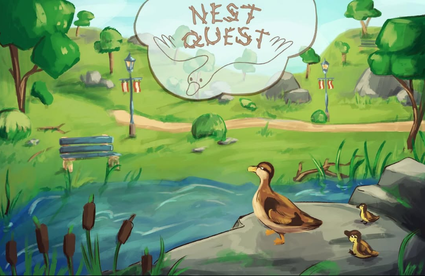

### My Role: Gameplay Programmer
*Made in Unreal Engine 5 | Team Size: 11*

Nest Quest is a third-person adventure platformer game where you play as Nessie the mama duck, searching the local park for your lost ducklings and supplies to rebuild your nest after a storm blows through. During this semester-long project, I worked on foundational game mechanics like player movement and collectables, as well as some of the UI elements in the game such as the HUD.

