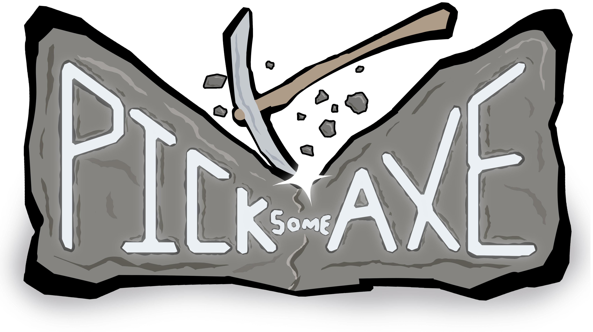

### My Role: Gameplay / UI Programmer
Made in Unity | Team Size: 13

Pick Some Axe is a third-person adventure game where you, Joe Miner, descend into the mines and take on the dastardly Pebblets to rescue your beloved, using your ability to dig into most surfaces to overcome obstacles. I was recruited to the project halfway through its development, joining for the second semester of a two-semester-long project. I worked on a variety of things for the game, including a major rework of the game's UI systems, a variety of minor gameplay features, and a small suite of developer tools for game testing.

